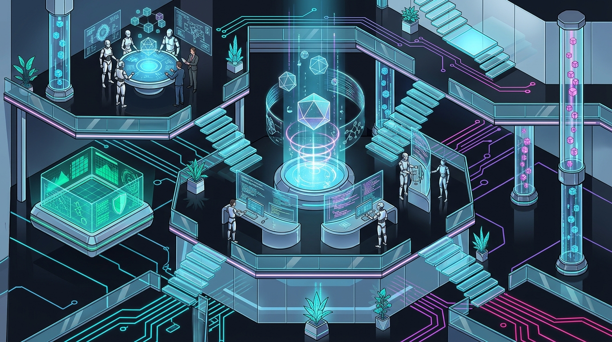
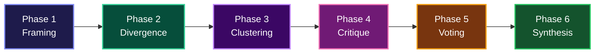
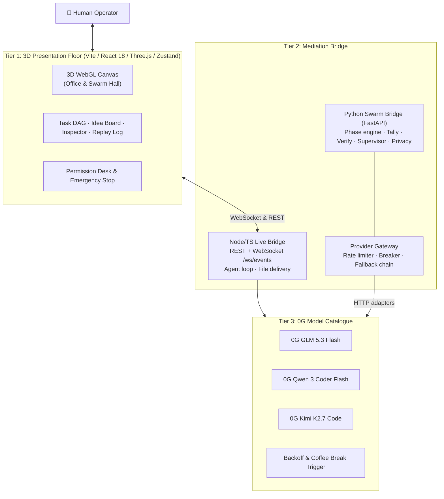
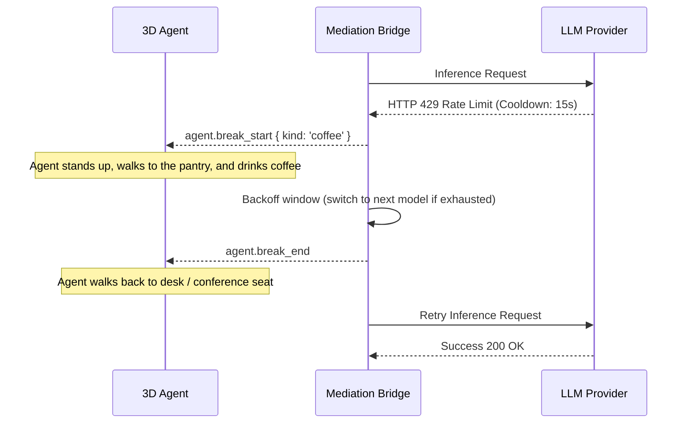

<!-- Animated Header with Walking AI Agents -->
<p align="center">
  
</p>

<!-- Hero Banner -->
<p align="center">
  
</p>

<!-- Badges -->
<p align="center">
  <a href="https://github.com/pritulsingh/AUTONEX"></a>
  <a href="#"></a>
  <a href="#"></a>
  <a href="#"></a>
  <a href="#"></a>
  <a href="#"></a>
</p>

<p align="center">
  <a href="#"></a>
  <a href="#"></a>
  <a href="#"></a>
  <a href="#"></a>
  <a href="#"></a>
  <a href="#"></a>
  <a href="#"></a>
  <a href="#"></a>
</p>

---

<p align="center">
  <b><i>"Where code is not just written — it is deliberated, architected, and proven."</i></b>
</p>

> **AUTONEX** is a next-generation autonomous engineering nexus. Instead of an isolated chatbot guessing in a terminal, AUTONEX orchestrates software development across an observable 3D spatial floor powered by **0G decentralized compute**, multi-agent consensus deliberation, and zero-trust permission boundaries.

---

## ⚡ Core Highlights

- **Dual-Engine Workflows:** Switch between **AUTONEX Virtual Office** (manager + backend, frontend and QA engineers) and **Swarm Hall** (10, 20, 30, 40 or 50 agents at a grand oval conference table).
- **Live LLM Execution:** Plans, proposals, critiques, votes and code deliverables use 0G Private Computer models exclusively, with role-specific fallbacks confined to the 0G model catalogue.
- **Real Tool-Using Agents:** Agents read files and PDFs, write code to disk, run shell commands and execute tests, every action gated by a permission request.
- **Visual Rate-Limit Backoff (Coffee Breaks):** On HTTP 429, the affected agent walks to the pantry, waits out the cooldown, and the bridge retries or switches to another configured 0G model.
- **Human-in-the-Loop Safety:** Permission modals for `file.read`, `file.write` and `shell.exec` (approve once / always / reject), plus an instant **Emergency Stop** that broadcasts `system.halted`.
- **Long-Context Model Support:** 0G model context limits are used for routing and request budgeting.
- **Replayable Event Stream:** Monotonic, seq-tracked WebSocket events with `since_seq` resume. Reconnects produce zero duplicate and zero missing events (tested).
- **Exportable Reports:** Final report view with PDF export (jsPDF), project bundle download (JSZip), and one-click git merge / discard of the agent branch.

---

## ✅ Implementation Status

| Area | Status | Details |
|---|---|---|
| 3D Office floor (14 zones, A* nav, door queues, wall sliding) | ✅ Done | Procedural low-poly agents, collision-free movement (tested), day/night, blueprint view, minimap |
| 3D Swarm Hall (oval table, inward seating, Idea Board) | ✅ Done | 10-50 agents, collision-free entrance simulation tested at n=10 and n=50 |
| Triage layer (task type + complexity → right-sized team) | ✅ Done | Solo manager, small team, or full department hire, driven by task kind and size |
| Event contract (36 event types, REST + WS) | ✅ Done | Documented in `frontend/docs/api-contract.md`, verified by a live-contract test |
| Live bridge (Node/TS) with real LLM calls | ✅ Done | Task planning, multi-file generation, tests, report, permission round-trips |
| Agent tool loop (`read_file`, `write_file`, `list_dir`, `execute_command`) | ✅ Done | Permission-gated, PDF/doc extraction helpers in Python |
| Swarm Hall live run | ✅ Done | Proposals, critiques, weighted Borda voting, agreement % and final synthesis all run on live LLM calls through the Python engine |
| Provider Gateway (Python) | ✅ Done | Token bucket, TPM window, priority queue with aging, AIMD on 429, circuit breaker, fallback chain. 16 tests |
| Swarm Engine (Python / FastAPI) | ✅ Done | Full 6-phase engine, real Borda tally, clustering, verification, supervisor, privacy firewall. 29 tests. Wired to live provider adapters |
| 0G model routing | ✅ Done | Role-specific 0G model catalogue and same-provider fallback chains |
| AUTONEX / PAG terminal agent (`backend/`) | ✅ Done | Docker sandbox, `strict` / `assist` / `turbo` profiles, egress allowlist, eval harness |
| Git merge / discard from the UI report | ✅ Done | Report buttons merge or discard the `agent/<timestamp>` branch |
| 0G Private Computer & iAI Hub | ✅ Done | 0G model inference (GLM-5.3, Qwen-3, Kimi), on-chain iAI staking verification (1.271 cr/day), personal_sign ownership challenge |
| Arkiv decentralized database (Rabdi Testnet) | ✅ Done | Schemas, wallet signing with tGLM, zero-gas public reads, verifiable ledger modal |
| Ethereum Swarm Context Storage | ✅ Done | Content-addressed storage (BZZ), SHA-256 integrity verification, on-chain Arkiv context referencing |

---

## ⚡ 0G Private Computer & iAI Holder Hub

AUTONEX integrates **0G Private Compute** and the **iAI token staking ecosystem** to deliver decentralized, high-throughput model inference for autonomous engineering agents:
- **Direct 0G Router Inference:** Agents execute complex reasoning across approved 0G models (`glm-5.3-flash`, `qwen3-coder-flash`, `kimi-k2.7-code`, and `qwen3.7-flash`).
- **Cryptographic Wallet Verification:** Proves wallet ownership via EIP-191 `personal_sign` nonce challenges (Chain ID: `16661`), establishing verifiable identity without exposing sensitive private keys.
- **iAI Staking Benefits:** Verifies on-chain iAI staked debt positions directly against the Vault contract (`0x3e1762e84ecdfb7042a9b6c4b2257d09618f03ff`). Eligible stakers unlock **1.271 indicative daily compute credits** per staked iAI.
- **Architecture & Technical Spec:** See [`docs/0G_ARCHITECTURE.md`](file:///d:/AUTONEX/docs/0G_ARCHITECTURE.md) and [`frontend/docs/IAI_0G_INTEGRATION.md`](file:///d:/AUTONEX/frontend/docs/IAI_0G_INTEGRATION.md).

---

## 🌐 Arkiv Network + Ethereum Swarm Decentralized Storage

AUTONEX integrates **Arkiv Network** as its native decentralized database layer and **Ethereum Swarm** as its content-addressed file storage layer. Simulation runs, multi-agent consensus proofs, and context references are anchored directly onto the **Rabdi DB-Chain Testnet**.

### Checkpoint storage and restore setup

Checkpoint history uses Arkiv for metadata and Ethereum Swarm for encrypted/binary
archives and AI context. Before using **Save / Upload** or restoring an older
checkpoint, copy `frontend/.env.example` to `frontend/.env` and set:

```env
VITE_AUTONEX_WORKSPACE_DIR=/absolute/path/to/the/active/project
```

The workspace path must be the actual project directory whose files AUTONEX
should capture or replace. Restart the Vite dev server after changing `.env`.
The browser cannot infer or access an arbitrary local directory, so leaving this
setting empty intentionally prevents destructive restore operations.

Arkiv setup:

1. Install/connect a wallet such as MetaMask.
2. Switch it to **Rabdi DB-Chain Testnet**, chain ID `7794095`.
3. Keep sufficient `tGLM` for Arkiv entity writes.
4. `VITE_ARKIV_ACCESS_KEY` is optional for reads, but recommended to avoid
   public endpoint rate limits.

Swarm setup:

1. `VITE_SWARM_GATEWAY_URL` defaults to the public Ethereum Swarm gateway.
2. For reliable uploads, configure a Bee gateway and a funded,
   usable `VITE_SWARM_POSTAGE_BATCH_ID`.
3. The postage batch ID is not required for read-only history retrieval when
   the configured gateway allows public reads.
4. `VITE_SWARM_TIMEOUT_MS` controls upload/download failure detection and
   defaults to `15000`.

If Arkiv or Swarm configuration is missing, existing local checkpoint metadata
is preserved and the UI reports the failed operation instead of overwriting the
active workspace.

Restoring a checkpoint changes the active branch head without deleting immutable
Arkiv records or Swarm objects. In the browser, that active head is persisted in
`localStorage`, so a refresh keeps the restored checkpoint active. This browser
pointer is profile-local; shared or cross-device branch state should use the
Node/SQLite checkpoint database or a separate Arkiv branch-head entity.

Checkpoint entities also include an Arkiv `is_active` flag. A restore patches
the selected entity to `true` and newer entities on the abandoned branch to
`false`; the binary Swarm objects remain untouched. Existing entities created
before this field was introduced are treated as active until a restore updates
their status. Arkiv writes require the connected Rabdi wallet and tGLM.

Checkpoint uploads use Arkiv's atomic mixed-schema batch transaction: the two
Swarm pointer entities and the checkpoint metadata entity are committed
together with one wallet confirmation. The first upload for a wallet/project
may still ask separately for the one-time user and project identity entities;
later checkpoints reuse those entities and require only the single checkpoint
batch confirmation.

### Why Arkiv + Swarm?
Traditional databases (Postgres, MongoDB) rely on centralized trust: a server operator can tamper with simulation outputs or alter multi-agent votes. Conversely, storing large multi-file codebase bundles and context files directly on blockchain smart contracts is cost-prohibitive. 

The **Arkiv + Swarm** dual architecture solves this:
1. **Arkiv DB-Chain as Single Source of Truth:** User identity (`autonex.user`), workspace projects (`autonex.project`), execution runs (`autonex.run`), and Swarm context references (`autonex.context_ref`) are indexed on-chain with structured queries.
2. **Ethereum Swarm Content-Addressed Storage:** Heavy context files, reports, and codebase archives are stored on Swarm, yielding a deterministic 64-hex BZZ reference.
3. **Cryptographic SHA-256 Integrity Verification:** Every Swarm reference anchored on Arkiv includes an immutable `sha256:...` digest. When retrieved, AUTONEX verifies bit-for-bit authenticity before displaying or unpacking.
4. **Zero-Gas Public Codebase Reads:** Anyone can query, audit, and unpack project files via standard JSON-RPC without paying gas.
5. **Wallet-Authorized Ownership:** Users own their simulation runs directly through their connected wallet (MetaMask) on Rabdi Testnet.
6. **Native Protocol Expiration (TTL):** Simulation entities default to a 90-day retention period, keeping storage fees minimal while enabling on-demand renewal (+90 days).

### Network Configuration:
- **Network Name:** Rabdi DB-Chain Testnet
- **Chain ID:** `7794095`
- **RPC URL:** `https://rpc.rabdi.db-chain.testnet.arkiv.network`
- **Native Currency:** `tGLM` (18 decimals)
- **Block Explorer:** [https://rabdi.explorer.arkiv.network](https://rabdi.explorer.arkiv.network)
- **Faucet:** [https://hub.arkiv.network/](https://hub.arkiv.network/)

### What is Stored on Arkiv vs Ethereum Swarm vs Off-Chain:
| Data Category | Storage Location | Schema Name | Reason & Privacy |
|---|---|---|---|
| **User Identity** | Arkiv DB-Chain | `autonex.user` | Checksummed wallet address, display name, account created timestamp |
| **Project Workspaces** | Arkiv DB-Chain | `autonex.project` | Project metadata, owner, active status, creation timestamp |
| **Swarm Context Pointers** | Arkiv DB-Chain | `autonex.context_ref` | Pointer linking project/report to Swarm BZZ content address + SHA-256 hash |
| **Simulation Runs** | Arkiv DB-Chain | `autonex.run` | Publicly verifiable execution record, status, owner |
| **Codebase Deliverables** | Arkiv DB-Chain | `autonex.deliverable` | Complete source code bundle (`bundle_bytes`), tests, score |
| **Swarm Deliberation Quorum** | Arkiv DB-Chain | `autonex.swarm_round` | Consensus proof, quorum %, semantic clusters, ballots |
| **Operator Permission Audits** | Arkiv DB-Chain | `autonex.audit_log` | Immutable safety trace of human permissions granted to agents |
| **Heavy Context & Report Files** | Ethereum Swarm (BZZ) | `bzz://<ref>` | Content-addressed large Markdown reports, JSON context manifests, file bundles |
| **Raw LLM Token Streams** | Off-chain (Ephemeral) | N/A | High-frequency streaming tokens (not cost-effective to store on-chain) |
| **Local OS File Buffers** | Off-chain (Local Disk) | N/A | Temporary local workspace files during live agent coding |

### Wallet Connection & tGLM Payments:
1. Click **Connect Wallet** in the top navbar (accessible both on the Landing screen and inside the Virtual Office).
2. If your wallet is on Ethereum or another network, the UI prompts you to switch to **Rabdi DB-Chain** (Chain ID: `7794095`).
3. To publish runs and store context references, request free testnet `tGLM` from [Arkiv Hub](https://hub.arkiv.network/).
4. When you click **"Store on Swarm & Anchor to Arkiv"** in the Final Report, the file is uploaded to Swarm, its SHA-256 integrity hash is computed, and your connected wallet signs an Ethereum transaction on Rabdi DB-Chain paying ~0.0001 `tGLM` in gas.
5. No private keys are ever exposed or stored; all signing is authorized explicitly by the user's browser wallet.

### Reproducible Arkiv + Swarm Verification:
Judges and reviewers can immediately verify the Rabdi DB-Chain and Swarm pipeline:
```bash
# Run the automated Arkiv + Swarm query reproducer
node scripts/reproduce-swarm-arkiv.mjs

# Or run the Arkiv run query reproducer
node scripts/reproduce-query.mjs
```
The script demonstrates:
1. Connecting to Rabdi DB-Chain RPC (Chain ID: `7794095`).
2. Executing all 6 Arkiv query shapes (`autonex.user`, `autonex.project`, `autonex.context_ref` by project, latest ref, by report ID, and public refs).
3. Deriving 64-hex Swarm BZZ content addresses.
4. Cryptographic SHA-256 integrity verification (100% bit-perfect match).

### Testing Instructions:
```bash
# Run full suite (16 test suites, 112 passing tests)
npm run check
```

### Decentralized Storage Documentation:
- Architecture & Pipeline Guide: [`docs/ARKIV_SWARM_ARCHITECTURE.md`](file:///home/pritul-singh/AUTONEX/docs/ARKIV_SWARM_ARCHITECTURE.md)
- Full Schema Specification: [`/arkiv/schema.md`](file:///home/pritul-singh/AUTONEX/arkiv/schema.md)
- Developer Friction & Feedback: [`/arkiv/friction.md`](file:///home/pritul-singh/AUTONEX/arkiv/friction.md)
- Architectural Justification: [`/arkiv/why-arkiv.md`](file:///home/pritul-singh/AUTONEX/arkiv/why-arkiv.md)
- Target Audience & Reach: [`/arkiv/reach.md`](file:///home/pritul-singh/AUTONEX/arkiv/reach.md)
- Reproducible Arkiv + Swarm Script: [`scripts/reproduce-swarm-arkiv.mjs`](file:///home/pritul-singh/AUTONEX/scripts/reproduce-swarm-arkiv.mjs)

---

## 🤖 Honest AI Usage Disclosure

In compliance with ETHGlobal hackathon rules:
- **Autonomous Simulation Logic:** GravityDesk uses 0G Private Computer models to generate plans, code deliverables, and multi-agent swarm debates.
- **Development Assistance:** AI coding assistants (Google Antigravity / Claude) were used as pair-programming tools during development to assist with TypeScript boilerplate, Three.js shaders, and test creation.
- **Architecture & Web3 Integration:** All schema designs (`autonex.*`), Arkiv SDK implementation, wallet authorization flows, and consensus verification logic were architected, tested, and validated by the team.

---

## 🏛️ Dual Working Modalities

### 1. AUTONEX Office Mode (Collaborative Sprint Execution)
Designed for iterative feature development, bug fixing and test-driven work:
- 👩‍💼 **Diya (Lead Manager):** Goal triage, task planning, glass-walled executive cabin and real-time operator chat.
- 👨‍💻 **Rohan (Backend Engineer):** APIs, schemas and system logic.
- 🎨 **Kabir (Frontend Engineer):** Component architecture, UI/UX and styling.
- 🧪 **Nisha (QA & Test Architect):** Edge cases, unit tests and acceptance verification.

**What you can do in the office:**
- Click any agent for the **Inspector** (status, task progress, energy, context meter, engine, live terminal/diff, follow-cam).
- Track work in the left panel: **org chart, task DAG and blackboard**.
- Watch the **event log with replay scrubber**, the **Compute & Cost drawer**, and the **Permission Desk**.
- Rank is visible by clothing: workers wear their department color, leads wear a deeper shade with a lanyard, the manager wears a suit and tie.
- Pantry, cafeteria, three meeting rooms, lounge and a server room that blinks on real LLM calls. Breaks are slow because walking is real.
- Keyboard: `Space` pause · `F` follow · `G` flows · `B` blueprint · `D` dev overlay · `Esc` close.

### 2. Swarm Hall Mode (Massive Consensus Synthesis)
Designed for high-stakes architectural synthesis and system design:
- **Amphitheater Seating:** 10, 20, 30, 40 or 50 agents seated around the central oval table.
- **10 Persona Roles:** Strategist, Skeptic, Domain Expert, Creative, Pragmatist, Risk Analyst, User Advocate, Fact-Checker, Engineer, Economist.
- **Idea Board:** Proposals and clusters appear live in 3D with per-cluster vote counts.
- **Output:** Multi-file projects are written to `output/<ProjectSlug>/`.

---

## 🔄 The 6-Phase Swarm Consensus Protocol



1. **Framing:** Moderator Diya deconstructs the prompt into constraints and architectural vectors.
2. **Divergence:** Agents draft independent proposals without seeing each other's output, which limits early bias.
3. **Clustering:** Proposals are grouped into design archetypes (similarity threshold `τ = 0.55`, up to 8 clusters, outlier tray for singletons).
4. **Adversarial Critique:** Each cluster is cross-examined with `SUPPORT` vs `CHALLENGE` stances. A solver assigns critics so no one reviews their own cluster, with a minimum number of critics, personas and model families.
5. **Weighted Borda Voting:** Ranked top-3 ballots (3/2/1 points), anonymized and shuffled, with reliability-weight clamping, a **veto rule** and **early-decision** detection once the margin is unassailable.
6. **Synthesis & Verification:** Multi-file code generation, checked by the L0-L3 pipeline before delivery.

**Verification pipeline (Python engine):**

| Level | Check | Gate |
|---|---|---|
| L0 | Syntax, write-set scope, clean apply | Hard |
| L1 | Lint, secret scan on the diff | Hard |
| L2 | Contract acceptance tests | Hard |
| L3 | Cross-examination tests | Scored |

**Supervision:** Deterministic zero-token watchdogs detect stalls, duplicate output, scope violations and budget burn. A supervisor arbiter handles escalation. Operators can `pause`, `resume`, `cancel`, `hint`, `kill_agent`, `raise_n_cell` or `reduce_active` mid-run.

---

## 🏗️ System Architecture



---

## ☕ Visual Rate-Limit Backoff (Coffee Breaks)



---

## 🔐 Safety & Privacy

**Permission Gate (live bridge):**
- `file.read`, `file.write` and `shell.exec` each raise a `permission.requested` event and block the agent until the operator answers `once`, `always` or `reject`.
- **Emergency Stop** (`POST /api/system/stop`) rejects every pending permission, marks runs done, returns all agents to IDLE and broadcasts `system.halted`.

**Egress Firewall (Python swarm engine):**
- Single choke point for outbound payloads with a provider **trust registry** and privacy modes.
- Local file classifier labels files `restricted` / `internal` / `public` (`.env*`, keys, certs and credentials are restricted by default).
- Secret and PII **redaction**, **pseudonymization**, payload minimization, **canary token** leak detection and a local audit log.

**AUTONEX / PAG Sandbox (`backend/`):**
- Docker-isolated agent with an nginx key-injecting LLM proxy (keys never enter the container), a Squid egress allowlist, and private SearXNG search.
- Three profiles: `strict` (asks before every edit), `assist` (default), `turbo` (auto-pilot on clean repos). `sudo`, `rm -rf`, `git push`, `ssh`, `scp` and `git reset --hard` are always denied.
- Agent work lands on a throwaway `agent/<timestamp>` git branch with a live audit pane and live diff pane.

---

## 🧰 Provider Gateway

Implemented in `bridge/autonex_bridge/gateway/` and covered by 16 tests:

- 0G-only model catalogue and role-based fallback chains
- Token-bucket limiter with safety margin and a sliding **TPM window**
- Priority queue with **aging** (no starvation), per-lane and global concurrency caps
- `429` / `Retry-After` handling with **AIMD** backoff
- `5xx` retry → **fallback chain**, context-length-aware routing (an over-context request is never sent to an 8k model)
- **Circuit breaker** (open / half-open / close) and auth-dead provider detection that never echoes keys
- Token estimator that learns from usage
- Load test: 50 concurrent requests at 20 rpm produce **zero provider 429s**

---

## 🚀 Quick Start Guide

### 1. Prerequisites
- **Node.js** 20+ & **npm** 10+
- *(Required, for live mode)* a 0G Private Computer API key (`ZG_API_KEY`)
- *(Optional, for the Python swarm engine)* Python 3.11+

### 2. Setup
```bash
git clone https://github.com/pritulsingh/AUTONEX.git
cd AUTONEX

# Environment variables
cp .env.example .env
# Add at least one key to .env (live mode only):
# OPENROUTER_API_KEY=sk-or-v1-...
# GROQ_API_KEY=gsk_...
# DEEPSEEK_API_KEY=...

# Install frontend dependencies
cd frontend
npm install
```

### 3. Run in Demo Mode (no keys needed)
```bash
cd frontend
npm run dev
```
Open `http://localhost:5173`, pick **Office** or **Swarm** mode, choose a task chip and enter the floor. Everything runs client-side with a synthetic simulator.

### 4. Run in Live Mode (real LLMs)
**Terminal 1 (Bridge):**
```bash
cd frontend
npm run bridge:mock      # REST + WebSocket on :8000
```

**Terminal 2 (3D Floor):**
```bash
cd frontend
echo "VITE_USE_MOCK=false" > .env.local
npm run dev
```

> On Windows, `scripts/start-all.ps1` launches both together.
> **Note:** the live runner writes deliverables under `D:\AUTONEX\output` (configurable in `frontend/tools/mock-bridge/realRunner.ts`).

### 5. Run the Python Swarm Engine
```bash
cd bridge
pip install -e ".[dev]"
uvicorn autonex_bridge.main:app --port 8001
```
Exposes `/api/swarm/estimate`, `/api/swarm/{run_id}/admission`, `/consent`, `/steer`, `/board`, `/egress`, `/phase`, `/ideas`, `/api/providers/health` and `/ws/events`. The 0G API key is read from the same `.env`.

### 6. Run the AUTONEX Terminal Agent
```bash
cd backend
cp .env.example .env && chmod 600 .env
./scripts/preflight.sh
./bin/pag /path/to/project assist
```
See [`backend/README.md`](backend/README.md) for profiles, model switching and key rotation.

---

## 🧪 Automated Test Suite

**Frontend (Vitest): 101 tests across 14 test suites**
```bash
cd frontend
npm test
```
```
 ✓ src/tests/integration.test.ts          (4 tests)
 ✓ src/tests/triage.test.ts              (10 tests)
 ✓ src/tests/live-contract.test.ts        (4 tests)   WebSocket resume, permission round-trip
 ✓ src/tests/swarmTape.test.ts            (3 tests)
 ✓ src/tests/swarmEntrance.test.ts        (2 tests)   n=10 and n=50, collision-free
 ✓ src/tests/stress.test.ts               (1 test)
 ✓ src/tests/swarmLayout.test.ts         (10 tests)
 ✓ src/tests/nav.test.ts                  (3 tests)
 ✓ src/tests/layout.test.ts               (3 tests)
 ✓ src/tests/zg-integration.test.ts      (22 tests)   0G Private Computer end-to-end suite
 ✓ src/tests/iai-integration.test.ts      (7 tests)   iAI Holder verification & compute billing
 ✓ src/tests/arkiv.test.ts               (22 tests)   Arkiv DB-Chain schemas, keys, RPC & tGLM
 ✓ src/tests/swarm.test.ts                (6 tests)   Ethereum Swarm BZZ & SHA-256 integrity
 ✓ src/tests/storage-workflow.test.ts     (4 tests)   Unified Arkiv + Swarm pipeline & tamper checks

 Test Files  14 passed (14)
      Tests  101 passed (101)
```

**Bridge (Pytest): 45 tests**
```bash
cd bridge
python -m pytest -q
```
```
 tests/gateway/test_gateway.py                          16 passed
 tests/swarm/test_privacy_and_egress.py                  5 passed
 tests/swarm/test_admission_and_estimator.py             4 passed
 tests/swarm/test_bus_and_phase_engine.py                3 passed
 tests/swarm/test_verifier_and_crossexam.py              3 passed
 tests/swarm/test_watchdogs_and_supervisor.py            3 passed
 tests/swarm/test_chaos_and_degradation.py               2 passed
 tests/swarm/test_clustering_and_assign.py               2 passed
 tests/swarm/test_controller_and_round_flow.py           2 passed
 tests/swarm/test_personas_and_distinctness.py           2 passed
 tests/swarm/test_tally_and_early_decision.py            2 passed
 tests/swarm/test_eval_harness.py                        1 passed

 45 passed
```

---

## 📁 Repository Layout

| Path | What lives there |
|---|---|
| `frontend/src/` | 3D office, swarm hall, UI panels, state store, A* navigation, simulator |
| `frontend/tools/mock-bridge/` | Node/TS live bridge: REST + WS server, agent loop, real runner, swarm runner |
| `bridge/autonex_bridge/gateway/` | 0G model gateway core (rate limiting, breaker, routing) |
| `bridge/autonex_bridge/swarm/` | Phase engine, tally, clustering, verification, supervisor, privacy, store |
| `bridge/config/` | `providers`, `models`, `departments`, `triage`, `swarm`, `personas` YAML |
| `backend/` | AUTONEX / PAG terminal agent: Docker, profiles, plugins, evals |
| `output/` | Projects generated during testing (InMemoryCache, RogueCrawler, CRYPTracker, CipherTool, AI Lab solutions) |
| `frontend/docs/` | Architecture, API contract, bridge spec, triage, acceptance tests |

---

## ⚠️ Known Limitations

- Agents are procedural low-poly figures, not motion-captured. Monitor screens are a static blue.
- The live runner's output directory is currently hard-coded (see the note in Quick Start, step 4).

---

<p align="center">
  <b>AUTONEX</b> · Built with 💜 for the next generation of autonomous engineering.
</p>
